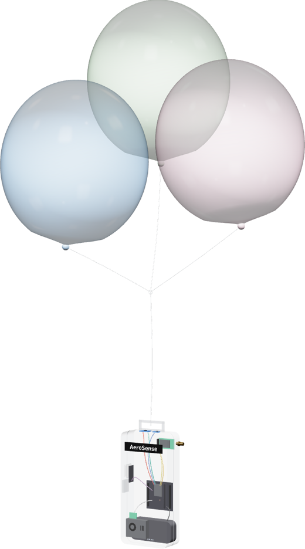
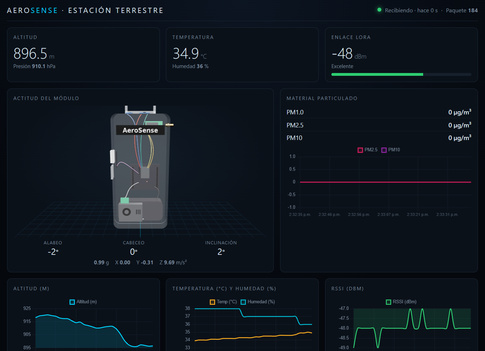

<div align="center">



# AeroSense

**Telemetría en tiempo real para un globo cautivo con helio**

Mide variables atmosféricas y partículas suspendidas, las transmite por LoRa a una estación en tierra y las publica en un panel web propio, Telegram, Blynk y ThingSpeak, con historial completo en SQLite.


Arquitectura de Computadoras · Instituto Tecnológico de Zacatepec (TecNM)

</div>

---

## Contenido

- [Características](#características)
- [Arquitectura](#arquitectura)
- [Hardware](#hardware)
- [Estructura del repositorio](#estructura-del-repositorio)
- [Puesta en marcha](#puesta-en-marcha)
- [Formato del paquete](#formato-del-paquete)
- [Registro en la PC](#registro-en-la-pc)
- [Resultados de las pruebas](#resultados-de-las-pruebas)
- [Problemas conocidos y soluciones](#problemas-conocidos-y-soluciones)
- [Equipo](#equipo)

## Características

- **Sensado:** temperatura y humedad (DHT22), presión y altitud (BMP180), actitud y vibración (ADXL345), material particulado PM1.0 / PM2.5 / PM10 (PMS7003M).
- **Enlace LoRa** E220-900T22D a 915 MHz con RSSI por paquete y conteo de paquetes perdidos.
- **Estación terrestre multitarea** con FreeRTOS: la recepción por radio nunca se bloquea por Wi-Fi o TLS.
- **Panel web** servido por el propio ESP32: gráficas en vivo y un modelo 3D del módulo que se inclina según el acelerómetro.
- **Bot de Telegram** con comandos y alertas (sin señal, PM2.5 alto, RSSI bajo).
- **Nube:** Blynk y ThingSpeak.
- **Historial en la PC:** servidor en Python sin dependencias que guarda registros y errores en SQLite, con visor web y exportación a CSV.

<div align="center">

<br><sub>Panel web de la estación terrestre.</sub>
</div>

## Arquitectura

```
┌──────────────────┐   LoRa 915 MHz   ┌────────────────────┐   HTTP (LAN)   ┌──────────────────┐
│   Globo (ESP32)  │ ───────────────▶ │  Tierra (ESP32)    │ ─────────────▶ │  PC: servidor    │
│ DHT22, BMP180,   │   E220-900T22D   │   E220-900T22D     │                │  Python + SQLite │
│ ADXL345, PMS7003M│                  │                    │                └──────────────────┘
└──────────────────┘                  └─────────┬──────────┘
                                                │ Wi-Fi
                         ┌──────────────┬───────┴──────┬──────────────┐
                         ▼              ▼              ▼              ▼
                     Panel web       Telegram        Blynk        ThingSpeak
                   (gráficas +     (comandos y
                    actitud 3D)      alertas)
```

El globo envía un paquete JSON cada 2 s. La estación de tierra lo recibe en una tarea de FreeRTOS dedicada (núcleo 0, prioridad alta), lo valida y lo reparte a los demás servicios, que corren en tareas propias en el núcleo 1. Las conexiones TLS (Telegram, Blynk, ThingSpeak) se serializan con un mutex para no agotar la memoria del ESP32.

### Módulos del receptor

| Módulo | Responsabilidad |
|---|---|
| `lora_rx` | Recibe y decodifica los paquetes del E220, adjunta el RSSI y cuenta paquetes perdidos por saltos de id. |
| `telemetria` | Estado compartido entre tareas, protegido con mutex (`telSnapshot()` entrega una copia consistente). |
| `web_server` + `web_page` | Panel web con Chart.js y Three.js; el modelo 3D se sirve desde `modelo_glb.h` en `/modelo.glb`. |
| `telegram_bot` | Comandos `/start`, `/datos`, `/estado` y alertas, en su propia tarea. |
| `nube` | Publica en Blynk y ThingSpeak cada 15 s, una tarea por servicio. |
| `tls_bloqueo` | Una sola conexión TLS a la vez (RAII sobre un mutex de FreeRTOS). |
| `registro_pc` | Envía paquetes y errores a la PC por lotes, con colas en RAM, reintentos con espera creciente y descarte controlado. |

## Hardware

| Componente | Función | Interfaz |
|---|---|---|
| 2 × ESP32 DevKit | Globo y estación terrestre | — |
| 2 × EBYTE E220-900T22D | Enlace LoRa 915 MHz | UART 9600 |
| DHT22 | Temperatura y humedad | 1 hilo |
| BMP180 | Presión y altitud | I²C |
| ADXL345 | Aceleración en 3 ejes (±16 g) | I²C |
| PMS7003M | PM1.0, PM2.5 y PM10 | UART 9600 (modo activo) |

**Conexiones del transmisor (globo)**

| Señal | GPIO |
|---|---|
| E220 TX → ESP32 RX | 16 |
| E220 RX ← ESP32 TX | 17 |
| E220 AUX | 15 |
| PMS7003M TX → ESP32 RX | 18 |
| PMS7003M RX ← ESP32 TX | 19 |
| DHT22 datos | 4 |
| I²C SDA / SCL (BMP180, ADXL345) | 21 / 22 |

El receptor usa los mismos pines 16, 17 y 15 para su E220. El esquemático completo está en [`AeroSense.fzz`](AeroSense.fzz) (Fritzing).

## Estructura del repositorio

```
AeroSense/
├── transmisor/                  Firmware del globo (PlatformIO)
├── receptor/                    Firmware de la estación terrestre (PlatformIO)
│   ├── include/secrets.h.example
│   └── src/                     lora_rx, telemetria, web_server, telegram_bot, nube, tls_bloqueo, registro_pc
├── herramientas/
│   ├── servidor_registro/       Servidor Python + SQLite con visor web
│   ├── configurar_e220_rssi/    Sketch de un solo uso que activa el byte de RSSI del E220
│   └── modelo_3d/               Genera el modelo 3D (.glb) y receptor/include/modelo_glb.h
├── docs/                        Imágenes del README
└── AeroSense.fzz                Esquemático (Fritzing)
```

## Puesta en marcha

### 1. Requisitos

- [VS Code](https://code.visualstudio.com/) con la extensión [PlatformIO](https://platformio.org/).
- Python 3.8 o superior en la PC (solo para el registro en SQLite).

### 2. Configurar el E220 (una sola vez)

Sube `herramientas/configurar_e220_rssi/` al ESP32 de tierra para activar el byte de RSSI. Ambos módulos deben usar el mismo canal y dirección.

### 3. Credenciales del receptor

```bash
cd receptor/include
cp secrets.h.example secrets.h
```

| Variable | Uso |
|---|---|
| `WIFI_SSID`, `WIFI_PASSWORD` | Red del receptor |
| `BOT_TOKEN`, `CHAT_ID` | Bot de Telegram |
| `BLYNK_AUTH_TOKEN` | Auth Token de la plantilla de Blynk (vacío = desactivado) |
| `THINGSPEAK_API_KEY` | Write API Key del canal (vacío = desactivado) |
| `REGISTRO_PC_HOST`, `REGISTRO_PC_PUERTO` | Opcional: IP y puerto de la PC (por defecto `192.168.137.1:8000`) |

`secrets.h` está en `.gitignore` y nunca se sube al repositorio.

### 4. Compilar y subir

Abre cada carpeta en PlatformIO y sube `transmisor/` al ESP32 del globo y `receptor/` al de tierra. Revisa `upload_port` en cada `platformio.ini`.

| Entorno del receptor | Uso |
|---|---|
| `esp32dev` | Firmware completo |
| `diagnostico` | Sin Telegram ni nube: aísla problemas del enlace LoRa |

El monitor serie guarda una copia con hora de cada línea en `receptor/logs/` (filtro `log2file`).

### 5. Usar

- **Panel web:** la IP que imprime el receptor al conectarse al Wi-Fi.
- **Telegram:** `/start`, `/datos`, `/estado`.
- **Blynk / ThingSpeak:** crea los datastreams y campos de la tabla siguiente.

| Variable | Blynk | ThingSpeak |
|---|---|---|
| ID de paquete | V0 | — |
| Altitud | V1 | Field 1 |
| Temperatura | V2 | Field 2 |
| Humedad | V3 | Field 3 |
| Presión | V4 | Field 4 |
| PM1.0 | V5 | Field 5 |
| PM2.5 | V6 | Field 6 |
| PM10 | V7 | Field 7 |
| RSSI | V8 | Field 8 |

## Formato del paquete

Una línea JSON por paquete, terminada en `\n`:

```json
{"id":5407,"alt":883.8,"pres":911.6,"temp":32.3,"hum":40,
 "pm":{"pm1":22,"pm25":32,"pm10":35},
 "acc":{"x":-0.04,"y":-0.39,"z":9.96}}
```

| Campo | Unidad | Nota |
|---|---|---|
| `id` | — | Contador; vuelve a 0 al reiniciar el transmisor |
| `alt` | m | Altitud barométrica con referencia de 1013.25 hPa |
| `pres` | hPa | |
| `temp`, `hum` | °C, % | `0` y `0` indican que falló la lectura del DHT22 |
| `pm.*` | µg/m³ | `null` mientras el PMS7003M no tenga una lectura reciente (por ejemplo, en los 30 s de arranque del ventilador) |
| `acc.*` | m/s² | |

El E220 agrega un byte de RSSI después del salto de línea; el receptor lo convierte a dBm.

## Registro en la PC

```bash
python herramientas/servidor_registro/servidor.py      # o doble clic en iniciar_servidor.bat
```

Abre `http://localhost:8000` para ver el enlace por sesión, los errores por tipo y los últimos registros. `/exportar/registros.csv` y `/exportar/errores.csv` descargan todo. Si el firewall de Windows pregunta, permite Python en redes privadas.

La base tiene dos tablas:

- **`registros`:** un renglón por paquete, con la hora real de llegada al receptor y el RSSI. La columna `sesion` sube cada vez que el transmisor se reinicia.
- **`errores`:** eventos con origen, tipo, detalle y cantidad.

Hay tres tipos de faltante que conviene no mezclar:

| Tipo | Quién lo detecta | Significado |
|---|---|---|
| `paquetes_perdidos` | Receptor | El paquete nunca llegó por LoRa. |
| `registros_descartados` | Receptor | Llegó por LoRa, pero la PC no lo recibió a tiempo y se descartó de la cola. |
| `huecos_en_registros` | Servidor | Ids que faltan en la base; suma de los dos anteriores. |

Los envíos van por lotes y son idempotentes: un reintento nunca duplica registros ni errores. Al actualizar el servidor, la base se migra sola y antes se guarda una copia `registros.db.antes-vN.respaldo`.

## Resultados de las pruebas

Prueba de laboratorio del 24 de noviembre de 2026, con todos los servicios activos:

| Métrica | Resultado |
|---|---|
| Duración | 3 h 10 min |
| Paquetes transmitidos | 5503 |
| Paquetes perdidos por radio | **0 (0 %)** |
| RSSI (mediana, 80 % de los paquetes) | −57 dBm (−63 a −49 dBm) |
| Registros guardados en la PC | 5480 (99.6 %) |

Los 23 registros que faltaron en la PC se debieron al manejo de reintentos del servidor, corregido después de esta prueba (ver la siguiente sección).

## Problemas conocidos y soluciones

| Síntoma | Causa | Solución |
|---|---|---|
| Cortes de señal LoRa | Jumper flojo en el receptor | Revisar conexiones del E220 |
| `SSL - Memory allocation failed` en Blynk | Varias conexiones TLS al mismo tiempo | `tls_bloqueo`: una sola conexión TLS a la vez |
| Envíos a la PC de 3 a 9 s y lotes atorados | Retransmisiones TCP y un reintento que el servidor no reconocía | Petición HTTP en una sola escritura, Wi-Fi sin ahorro de energía y servidor idempotente |
| PM en 0 casi siempre, con un valor real cada 32 paquetes | El transmisor leía un solo byte del PMS7003M por envío (una trama mide 32 bytes) | Vaciar el búfer UART en cada vuelta del `loop()` y mandar `null` sin lectura; el servidor convierte los 0 antiguos en vacíos |
| Advertencias `deprecated` de ArduinoJson | La librería UniversalTelegramBot usa la API anterior | Silenciadas con `-Wno-deprecated-declarations`; no afectan el funcionamiento |

## Equipo

- Mastache De la Paz David
- Ramírez Díaz Salvador
- Sánchez Julián Isaac

Proyecto académico para la materia de Arquitectura de Computadoras, Instituto Tecnológico de Zacatepec (TecNM). Uso libre con fines educativos. El reporte del proyecto contiene la justificación técnica, el cálculo de sustentación y las pruebas completas.
